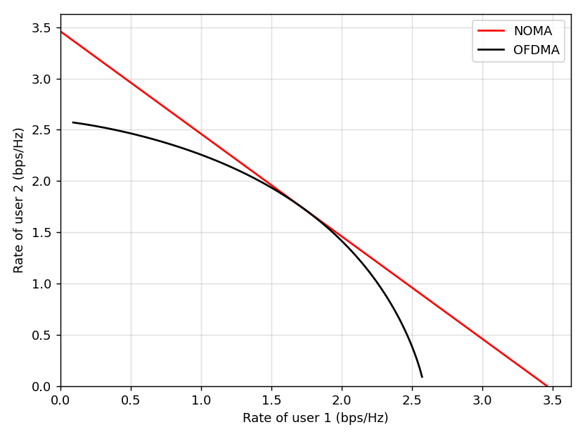
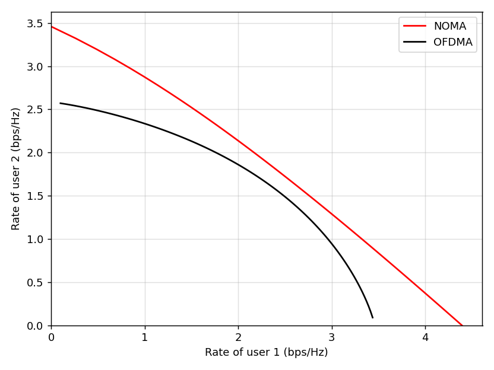
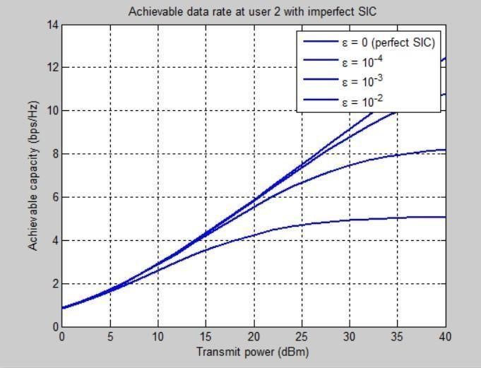
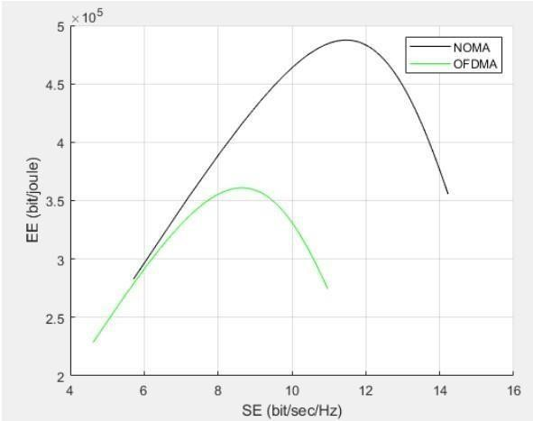

# Performance Analysis of NOMA in 5G Networks

Graduation project, B.Sc. (Honours) in Network and Telecommunication Engineering  
**Sudan International University – Faculty of Engineering** (March 2022)

**Students:** Rogea Abo Algasim Mohamed Ahmed (ET-16-043), Tanzel Moutasim Mohammed Daowd (ET-16-045), Hadeel Ismat Abd-Alla Mohamed-Ali (ET-16-018)  
**Supervisor:** Dr. Ibrahim Khider Eltahir

## About

This project studies **Non-Orthogonal Multiple Access (NOMA)** as a multiple-access technique for 5G and compares it with **OFDMA**. It covers superposition coding, Successive Interference Cancellation (SIC), downlink/uplink NOMA, imperfect SIC, and the spectral-efficiency / energy-efficiency (SE–EE) trade-off. The simulations are written in MATLAB.

## Repository structure

```
├── src/
│   ├── fig4_1_rate_pairs_equal_snr.m     # NOMA vs OFDMA rate pairs, equal channel gains
│   ├── fig4_2_rate_pairs_unequal_snr.m   # NOMA vs OFDMA rate pairs, asymmetric channels
│   ├── fig4_3_imperfect_sic.m            # User-2 rate vs transmit power with SIC error
│   └── fig4_4_ee_se_tradeoff.m           # EE–SE trade-off, NOMA vs OFDMA
├── results/                              # Result figures
├── docs/
│   ├── NOMA_5G_Graduation_Report.docx    # Full project report
│   └── CODE_REVIEW_NOTES.md              # Differences between report and code, and the fixes
├── LICENSE
└── README.md
```

## How to run

1. Install MATLAB (or GNU Octave, which runs these scripts with minor differences).
2. Clone the repository:
   ```bash
   git clone https://github.com/<your-username>/noma-5g-performance-analysis.git
   ```
3. Open MATLAB, set the current folder to `src/`, and run any script, e.g.:
   ```matlab
   fig4_3_imperfect_sic
   ```

Each script is self-contained and produces one figure of Chapter 4.

## Results

**Fig 4.1 – Rate pairs, G1 = G2 = 10**



**Fig 4.2 – Rate pairs, G1 = 20, G2 = 10**



**Fig 4.3 – Achievable rate at user 2 with imperfect SIC**



**Fig 4.4 – EE–SE trade-off, NOMA vs OFDMA**



Main findings (see the report for details):

- NOMA achieves larger rate regions than OFDMA, especially when the users' channel conditions differ.
- Imperfect SIC limits the rate of the far user at high transmit power.
- NOMA reaches higher energy efficiency and spectral efficiency than OFDMA in the downlink.

## Notes

The scripts were reviewed against the report; see [docs/CODE_REVIEW_NOTES.md](docs/CODE_REVIEW_NOTES.md) for the fixes and the justification.

## License

Released under the [MIT License](LICENSE).
